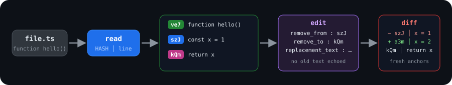

<p align="center">
  
</p>

<h1 align="center">dsh-better-edit</h1>
<p align="center">
  <strong>High-precision, hash-anchored file editing for DeepSeek Harness (dsh).</strong><br>
  Replaces fragile line numbers and token-wasting code echoes with content-addressed line hashes &mdash; 0 silent miswrites, 0 token re-reads.
</p>
<p align="center">
  <strong>English</strong> ·
  <a href="README.zh.md">简体中文</a>
</p>

<p align="center">
  <a href="#why-you-need-it"></a>
  <a href="#quick-start"></a>
  <a href="#benchmark"></a>
</p>

<p align="center">
  <a href="#why-you-need-it">Why You Need It</a> •
  <a href="#core-pillars">Core Pillars</a> •
  <a href="#quick-start">Quick Start</a> •
  <a href="#tools">Tools</a> •
  <a href="#benchmark">Benchmark</a> •
  <a href="#how-anchors-work">How Anchors Work</a> •
  <a href="#development">Development</a>
</p>

<p align="center">
  
  
  
  
  
  
</p>

<p align="center">
  
</p>

---

> **What is `dsh-better-edit`?**
> A high-precision file editing plugin for [DeepSeek Harness (`dsh`)](https://github.com/deepseek-ai) that replaces volatile line numbers and token-wasting code echoes with immutable, content-addressed 3-character line hashes (`szJ│code`).
>
> **Core Philosophy:** Local compute is free; **the model's context window is the most precious resource**. By shifting verification, snapshotting, and alignment to the host, `dsh-better-edit` slashes output tokens by 40–60%, auto-rebases external file drift (e.g., Prettier, Git), and eliminates silent miswrites without forcing full-file re-reads.

---

## Why You Need It

### The 3 Fatal Editing Traps of Autonomous Coding Agents

File editing is the #1 point of failure for autonomous agents. Traditional tools break down in three distinct ways:

| Fatal Trap in Traditional Tools | Why It Breaks Agents                                                                                                             | How `dsh-better-edit` Solves It                                                                                                                                                                                 |
| ------------------------------- | -------------------------------------------------------------------------------------------------------------------------------- | --------------------------------------------------------------------------------------------------------------------------------------------------------------------------------------------------------------- |
| **`str_replace` Token Bleed**   | Must re-type 30+ lines of unchanged code just to change 1 line ($O(S+R)$), burning expensive output tokens (billed ~5–6× input). | **$O(R)$ Payloads**: Sends only two 3-char hashes (`anchor_from`, `anchor_to`) + replacement. Cuts output tokens by 40–60%.                                                                                     |
| **Line-Number Coordinate Rot**  | Inserting 1 line shifts all line numbers below it. Agents suffer off-by-one errors or must repeatedly re-read the file.          | **Position-Independent Anchors**: Line hashes follow content, not line coordinates. Exterior shifts auto-rebase cleanly.                                                                                        |
| **Silent Miswrites & Drift**    | Duplicate lines match the wrong function; external formatters (Prettier) or git updates cause blind overwrites or fatal errors.  | **Content-Addressed Line Verification**: anchors derive from raw line bytes, unique via coprime probing; a re-indent survives through the lease; interior whitespace significant; fail-closed reject-and-serve. |

---

## Core Pillars

### 1. 🪙 Token Economics (40–60% Context Savings)

- **$O(R)$ Edit Payloads**: The model emits only `{ "path": "...", "edits": [["a1b", "c3d", "..."]] }`, never echoing existing code.
- **Self-Serving Diffs**: Every applied edit returns fresh anchors in the post-edit diff — zero re-read roundtrips to chain edits.
- **Zero-Token Auto-Rebase**: Non-conflicting exterior shifts resolve locally without agent intervention — 0 tokens, 0 retries.
- **Atomic Multi-Item Batches**: Apply up to 32 same-file edits in one tool call; overlapping spans abort atomically (`[E_BATCH_ABORT]`) before touching disk.

### 2. 🛡️ Resistance to External Writes (Drift & Concurrency)

- **Edge-Whitespace Tolerance**: Anchors derive from the line's raw bytes; the alignment digest trims one leading and one trailing whitespace run. A re-indent or trailing-space strip keeps the held anchor valid through the lease (the spelling rotates with the bytes, the lease does not); interior whitespace — inside string literals too — is significant, and a change to it rejects fail-closed.
- **Exterior Shift Auto-Rebase**: External edits, git checkouts, or background processes outside the edit span rebase seamlessly without agent intervention.
- **Fail-Closed Reject-and-Serve**: Contested interior spans fail closed without disk corruption and immediately return fresh on-disk rows in the error (`[E_STALE_RANGE]`, `[E_UNSERVED_RANGE]`) — those rows are **recorded as served** (rows, canons, snapshot and leases, exactly like a `read` of those lines), so retry needs no `read`. Two exceptions keep the report honest: a refusal raised after an earlier item of the same call already changed the temporary buffer shows no rows and names the current-file lines an anchored read would serve, and a window whose echoed anchor the served mirror already holds elsewhere is not recorded and says so.
- **Session-Keyed Leases**: Leases are isolated per session, preventing cross-agent race conditions or state pollution.

### 3. 🎯 Zero Silent Miswrites

- **Decoupled Line Identity**: Lines are verified against served snapshot lineage, not ephemeral line coordinates.
- **Collision-Free Anchors**: Coprime bitset probing ensures duplicate lines in a file receive distinct, unambiguous 3-character hashes.
- **No Heuristic Guessing**: Retires fuzzy matching. If an anchor cannot be unambiguously resolved, it fails closed safely.
- **Persisted Undo**: `undo_last_edit` restores the previous content at the **effective EOL** as UTF-8 (BOM and original anchors too, persisting across session restarts). A pre-edit mixture of line endings is **not** restored — the revert writes one ending and says so; a migrated legacy file comes back as UTF-8 text — the revert names the abandoned codec and its BOM, but the original bytes do not come back.

---

> _"The harness — not the model — is the bottleneck."_ — Can Bölük, [_The Harness Problem_](https://stencil.so/blog/the-harness-problem)
>
> **3 calls vs 6 · -55.8% tokens · 23/23 correctness.** Tested on realistic external-drift refactoring against OMP wrapper. Payload numbers are deterministic — see [Benchmark](#benchmark).

## Quick Start — install to verified edit in 30s

### Install (pick one)

```sh
npx @deepseek-ai/dsh plugin --profile web add github:Rianico/dsh-better-edit   # from github
npx @deepseek-ai/dsh plugin --profile web add dsh-better-edit                 # from npm
npx @deepseek-ai/dsh plugin --profile web add /path/to/dsh-better-edit       # local
```

No config. Next session runs with hashline tools. Verify:

```sh
dsh --profile <name> --dump-config   # shows "# == dsh-better-edit" layer
```

| Requirement |                                                                                   |
| ----------- | --------------------------------------------------------------------------------- |
| Node        | `>=24` (per `engines.node`; a newer dsh host may require a higher minimum)        |
| Profile     | `dsh` profile (`dsh plugin` creates one)                                          |
| Backends    | sandboxed / remote `ctx.fs`                                                       |
| dsh         | `0.2.1-rc.2` (verified end-to-end; `0.1.6-alpha.2` was the last pre-0.2 baseline) |

**dsh 0.2.0+ is supported.** Registration uses `agent/created`, path resolution follows the session's live working directory (`workingDirectory`, with the session header as the pre-0.2.1 fallback), and tool-guidance order comes from `systemPrompt.getSectionOrder`. There is no peer range and no runtime version probing: compatibility comes from that stable surface plus optional-service fallbacks, so a composition that omits `workingDirectory` or `agentPresets` keeps working.

### See it work

`read` serves `HASH│content` — the hash _is_ the address:

```text
ve7│function hello() {
szJ│  console.log("world");
kQm│}
```

`edit` by hashes — always lands where you meant:

```json
{ "path": "src/main.ts", "edits": [["szJ", "szJ", "  console.log('hi');"]] }
```

Returns a diff with fresh anchors — next edit needs no `read`:

```text
- szJ │   console.log("world");
+ a3m │   console.log('hi');
  kQm │ }
```

Under `hint` mode a removed row this session never served renders the empty gutter (`-   │content`) instead of an anchor, and a folded deletion appends ` (N unserved)` to its `[N lines deleted]` marker — the diff never hands back an anchor the session cannot honour.

**Position-free in one line:** `read 1..5` → `insert @0` → `edit 10..12` still verifies `10..12` (`resist` mode). **Multi-session honesty:** `A:10..12+1` shifts `B:20..30→21..31` → `B` passes (drift notice); `B:12..13` overlapping `A` → `E_STALE_RANGE` + fresh rows, one retry.

Batch atomically — one `edit`, up to 32 same-file ranges:

```json
{
  "path": "src/main.ts",
  "edits": [
    ["a1b", "a1b", "new line 1\n"],
    ["c3d", "c3d", "new line 2"]
  ]
}
```

One fails → none write (`[E_BATCH_ABORT]`).

> [!TIP]
> **Want proof before you install?** Upstream [23/23 battery](https://github.com/Rianico/pi-better-edit/blob/main/benchmarks/README.md) runs no LLM — stale edits are rejected every run. Same algorithm.

### Configuration

Tenancy and prompt guidance declare once, read at `agent/created`, no code change.

**Store** central by default `$DSH_HOME/plugins/dsh-better-edit/runtime/<name>-<hash8>/` (`ls`-readable + `.wsPath` sidecar). DBs are disposable caches — `rm -rf runtime/<name>-<hash8>/` is safe, rebuilt on next `read`.

```yaml
# $DSH_HOME/plugins/dsh-better-edit/config.yaml
storeDir: central # central | workspace | /abs
autoGitignore: false
spanMode: hint # hint | strict — strict refuses an interior line never served (audit/CI)
eol: AUTO # AUTO (file's dominant, then OS) | LF | CRLF | CR — LF for .gitattributes repos
undo_ttl_s: 604800 # 7d, -1 forever
storeMaxAgeS: 2592000 # 30d janitor
storeMaxTotalBytes: 524288000 # 500 MB LRU
```

Env overrides yaml (`DSH_BETTER_EDIT_STORE_DIR`, `DSH_BETTER_EDIT_AUTO_GITIGNORE`, `DSH_BETTER_EDIT_SPAN_MODE=hint|strict`, `DSH_BETTER_EDIT_EOL`).

**Span mode** — `strict` for audit, CI or review sessions where an unreviewed interior must never be replaced; `hint` for interactive work where the model usually knows the span it replaces. `hint` (the default) applies the edit and discloses the replaced interior with `[W_UNSERVED_INTERIOR]`; `strict` refuses before any write with a rowless `[E_UNSERVED_RANGE]` that counts the replaced span and lists the unserved file-line numbers. No per-call override — the profile owns the policy. See [ADR-0045](docs/adr/0045-strict-span-mode.md).

**Line endings** — every `edit` writes **one** effective EOL, resolved `DSH_BETTER_EDIT_EOL` > `eol` (config) > the file's dominant terminator (whole file; ties prefer LF, then CRLF, then CR) > the system ending (`\r\n` on Windows, `\n` elsewhere). `AUTO` follows the file's dominant ending, and a file that spells **no** terminator falls back to **the system ending** — so the same edit writes `\r\n` on a Windows host and `\n` on a Linux host. Set `eol: LF` in cross-platform repositories that rely on `.gitattributes` and need one spelling on every host; `LF`/`CRLF`/`CR` force that ending. A file that mixes endings says so on read — `[W_MIXED_EOL] Mixed EOL: 2 CRLF, 1 LF. All edits normalize to CRLF (file).` — and an edit that re-spells terminators reports `[MODEL] [W_EOL_REWRITTEN] EOL normalized to CRLF (file): 1 terminators changed. Undo restores normalized content.` `undo_last_edit` restores at that same effective EOL and names it when a pre-edit mixture could not come back.

**File encoding** — a `read` records the file's `{encoding, hasBOM}` and a later write must reproduce those bytes through a text-only seam that always encodes UTF-8. A legacy file that cannot round-trip (UTF-16, or `windows-1251` with non-ASCII content) therefore refuses with `[E_ENCODING_UNWRITABLE]` — nothing is written, nothing is silently transcoded, and the served anchors still describe the bytes on disk. A conversion needs an explicit consent and a UTF-8 target, and the default is `refuse`: name `allow_encoding_migration: "utf8"` or `"utf8bom"` on the `edit` payload for one call, or set the standing `allowEncodingMigration` config setting (`DSH_BETTER_EDIT_ALLOW_ENCODING_MIGRATION`, values `refuse | utf8 | utf8bom`); the legacy `normalizeToUtf8: true` is still honoured as `"utf8"`. `"utf8"` writes the migrated file without a BOM; `"utf8bom"` writes one leading `EF BB BF`, which BOM-aware readers decode as UTF-8. The conversion is a one-way door the applied result carries as `[W_ENCODING_MIGRATED]` and the revert names but never reverses (`undo_last_edit` restores the text as UTF-8 — behind the target's BOM after a `"utf8bom"` migration — while the original codec and its BOM are gone). Reopen bytes under another codec with `read({ encoding })` (e.g. `windows-1251`); the `autoGuessEncoding` gate (`DSH_BETTER_EDIT_AUTO_GUESS_ENCODING`, default `false`) auto-decodes only after deterministic BOM → strict-UTF-8 detection fails: a guess it is not confident about is reported on the read together with its Top-3 candidates, and a file it cannot decode is refused with the Top-3 for the model to pick from. Guessing ranges over `supportedEncodings` (`DSH_BETTER_EDIT_SUPPORTED_ENCODINGS`, default `gbk, big5, shift_jis, euc-kr, windows-1251, iso-8859-1`); UTF-8 is always accepted outside that list — the deterministic BOM → strict-UTF-8 pass runs before any guessing. An ASCII-only file under a legacy name is byte-faithful and edits silently at every consent — its bytes are already UTF-8 and no BOM is added.

**Guidance per preset** — `tool:read` / `tool:edit` / `tool:undo_last_edit` are plain markdown per preset at `$DSH_HOME/plugins/dsh-better-edit/<preset>/<section>.md`. The default order is the harness's own tool slot (`systemPrompt.getSectionOrder`: `1100` read, `1300` edit, `1310` undo), so a band change upstream moves the sections with it. A fresh install seeds the shipped presets — `standard`, `ptc`, `minimal`, `cordis` — with the compiled default body and writes **no** `order:` fence; a hand-written `order` front-matter still pins a custom position. An unmodified seeded file refreshes itself when a release changes the compiled default, while a file you edited is preserved byte-identically and listed in one boot warning — together with any stale or customized file in a custom preset. A deliberate blank (`---\n---\n`) is preserved silently. Delete or empty a file → the default re-seeds at next boot. A local override that diverges from the default appends the `[USER] [W_PROMPT_DIVERGED]` footer to its section text. See [ADR-0052](docs/adr/0052-guidance-seed-provenance-and-upgrade-lifecycle.md).

## Why Hashline

**Verified against what was served.** Every line the session has served evidence for is checked against `read`/diff/rejection rows. The two **boundary** anchors must still resolve, but a boundary pair does not prove the model saw the lines between them: on the leased route it can authorize a span across unserved **interior** lines, so a never-served line is not by itself a refusal (`hint` discloses the replaced interior; `spanMode: strict` refuses it). Read one contiguous range when the interior matters. A stale boundary → `[E_STALE_RANGE]`/`[E_UNSERVED_RANGE]` + fresh `HASH│content` recorded as served, so the retry needs no `read`; a refusal that shows no rows (a changed batch buffer, `[E_TARGET_LOST]`, an unresolved anchor) records nothing and names the read. Session-scoped — sub-agent serves never validate main edits.

**Content-addressed.** The anchor is `xxh32` over the line's raw bytes → `62³=238,328` anchors, while `canon(line)` — one leading and one trailing whitespace run trimmed — is the alignment digest that pairs snapshots and verifies served evidence. Re-inserting identical text keeps its hash; a re-indent or trailing-space pass between edits rotates the spelling but not the lease, so the held anchor keeps working. Interior whitespace is significant — `"a b"` and `"ab"` are different lines, even inside a string literal. Unique by bitset probing — `}`/`import` repeats never collide; cap `238,328` lines (`[E_LARGE_FILE]`).

**No loop, no ritual.** No-op → `No changes made`; same no-op ×3 → `[E_NOOP_LOOP]`. Diff and row-carrying rejection rows count as serves — only a rowless refusal names a `read`, and `read` is recovery, not ritual.

### Token economics

Envelope change: hoist `path`, `edits:[[from,to,text]]`, never repeat `old_string`.

| snapshot              | `str_replace` |         `edit` |   `edit` multi |   OMP per-edit |      OMP batch |
| --------------------- | ------------: | -------------: | -------------: | -------------: | -------------: |
| pinned 12-edit corpus |         1,015 | 609 **-40.0%** | 582 **-42.7%** | 590 **-41.9%** | 480 **-52.7%** |
| local snapshot        |           358 | 272 **-24.0%** | 241 **-32.7%** | 268 **-25.1%** | 180 **-49.7%** |

Percent vs `str_replace`. External row pinned corpus, `cl100k_base`; local `npm run benchmark` in upstream.

| engine          | calls | tokens |      saved | ok  |
| --------------- | ----: | -----: | ---------: | :-: |
| OMP             | **6** | 28,467 |          — | ✅  |
| hashline `edit` | **3** | 12,593 | **-55.8%** | ✅  |

Single stochastic run, `opencode-go/gpt-5.6-luna` high. [Artifact](https://github.com/Rianico/pi-better-edit/blob/main/benchmarks/results/2026-08-17-practical-token-benchmark.md).

> **Scope & honesty.** Payload deterministic; practical run stochastic. We measure **payload + round-trips**, not throughput. Retries are where the gap is largest — see [edge cases](#comparison).

## Tools

| Tool             | What it does                                                                                                                         |
| ---------------- | ------------------------------------------------------------------------------------------------------------------------------------ |
| `read`           | `HASH│content` with `offset`/`limit`; `[Showing N-M of T]` paging; `>200KB` lines show marker                                        |
| `read_skill`     | Plain text, no hashes, no serves — editing after it needs a serve                                                                    |
| `edit`           | `{file, edits:[[from,to,text]]}` (named objects too; `path`/`file_path` aliases fold), `""` deletes, atomic ≤32, verify-then-write   |
| `undo_last_edit` | `{path}` restores last edit at its effective EOL as UTF-8 (BOM/anchors too), names a lost mixture or a migrated codec+BOM, persisted |

`write` stays, but refuses an exact `HASH│` echo for same `session/path/line` before dispatch.

### Error codes

| Code                      | Meaning                                                                                              | What to do                                                                                                                                                               |
| ------------------------- | ---------------------------------------------------------------------------------------------------- | ------------------------------------------------------------------------------------------------------------------------------------------------------------------------ |
| `[E_BAD_PAYLOAD]`         | Request shape is wrong (unknown field, missing `file`, bad tuple)                                    | Fix the shape and resend                                                                                                                                                 |
| `[E_MALFORMED_ANCHOR]`    | The anchor token is not a bare 3-char anchor (pasted block or pseudo-anchor)                         | Pass the bare anchor and retry                                                                                                                                           |
| `[E_UNKNOWN_ANCHOR]`      | The anchor was never served for this file                                                            | `read` the file for fresh anchors                                                                                                                                        |
| `[E_FOREIGN_ANCHOR]`      | The anchor belongs to another file or session                                                        | Use anchors served for this file                                                                                                                                         |
| `[E_STALE_ANCHOR]`        | The anchor no longer resolves (hash / retired / canon miss)                                          | `read` for fresh anchors                                                                                                                                                 |
| `[E_AMBIGUOUS_MATCH]`     | `str_replace` `old_str` matches more than once                                                       | Narrow `old_str`                                                                                                                                                         |
| `[E_NO_MATCH]`            | `str_replace` `old_str` is absent                                                                    | Re-`view` and retry                                                                                                                                                      |
| `[E_EMPTY_RANGE]`         | The edit would empty a non-empty file                                                                | Use `write`                                                                                                                                                              |
| `[E_STALE_RANGE]`         | The served range changed on disk                                                                     | Apply the echoed fresh rows (recorded as served); a rowless refusal names the `read`                                                                                     |
| `[E_UNSERVED_RANGE]`      | A boundary anchor never resolved, or — in `strict` — the span replaces an interior line never served | `hint`: use the echoed rows (recorded as served), or `read` when the refusal is rowless. `strict`: the rowless refusal names the unserved file-line numbers; `read` them |
| `[E_UNVERIFIED_RANGE]`    | A boundary anchor could not be verified against served state                                         | `read` and retry                                                                                                                                                         |
| `[E_SUSPICIOUS_TEXT]`     | Replacement text carries copied `HASH│` or diff-preview markers                                      | Remove them and resend                                                                                                                                                   |
| `[E_BLIND_REPLACE]`       | `write` / `str_replace_editor` ran before the file was observed                                      | `read` / `view` first                                                                                                                                                    |
| `[E_TARGET_LOST]`         | The target vanished or changed identity mid-operation                                                | `read` and re-target                                                                                                                                                     |
| `[E_BATCH_ABORT]`         | One item failed; nothing was written                                                                 | Fix the item and resend the batch                                                                                                                                        |
| `[E_NOOP_LOOP]`           | The same no-op edit was resubmitted                                                                  | Change the edit                                                                                                                                                          |
| `[E_ACCESS]`              | The path is not readable or writable                                                                 | Fix the permission                                                                                                                                                       |
| `[E_NOT_FOUND]`           | No such file                                                                                         | Check the parent directory                                                                                                                                               |
| `[E_FILE_EXISTS]`         | A `create` target already exists                                                                     | Choose a new path                                                                                                                                                        |
| `[E_UNSUPPORTED_FILE]`    | Directory, binary, or non-text file                                                                  | Choose a text file                                                                                                                                                       |
| `[E_ENCODING_UNWRITABLE]` | The recorded encoding cannot be reproduced by a UTF-8 text write                                     | Send `allow_encoding_migration: "utf8"` or `"utf8bom"` on the edit (or set `allowEncodingMigration`), or re-encode the file outside the plugin                           |
| `[E_UNSUPPORTED]`         | `str_replace_editor undo_edit` is not implemented                                                    | Use `undo_last_edit`                                                                                                                                                     |
| `[E_BAD_COMMAND]`         | Unknown `str_replace_editor` command                                                                 | Use `view`, `str_replace`, `insert`, or `create`                                                                                                                         |
| `[E_LARGE_FILE]`          | Above the line or anchor-space limit                                                                 | Use `write` or split the file                                                                                                                                            |
| `[E_UNDO_STALE]`          | The file changed after the edit                                                                      | No undo; re-read                                                                                                                                                         |
| `[E_UNDO_UNAVAILABLE]`    | Undo history could not be persisted                                                                  | Retry the edit                                                                                                                                                           |
| `[E_UNDO_NOT_RECORDED]`   | The revert landed but the store could not record it                                                  | Re-read; the next undo clears the stale history                                                                                                                          |
| `[E_STORE_NEWER_VERSION]` | The store was written by a newer plugin version                                                      | Upgrade the plugin, or point the store elsewhere                                                                                                                         |
| `[E_UNKNOWN]`             | Unexpected internal error                                                                            | Report it; the message is preserved                                                                                                                                      |

`ERROR_REGISTRY` in `src/domain-errors.ts` is the source of truth for this table; `test/arch/error-table-vocabulary.test.ts` fails when the two disagree.

### Warning codes

| Code                    | Meaning                                                                                                                                                              | What to do                                                                                                                                  |
| ----------------------- | -------------------------------------------------------------------------------------------------------------------------------------------------------------------- | ------------------------------------------------------------------------------------------------------------------------------------------- |
| `[W_UNSERVED_INTERIOR]` | `hint` mode applied an edit whose replaced span included interior lines this session never served                                                                    | Verify the uninspected replacement was intended; `spanMode: strict` refuses it instead                                                      |
| `[W_EOL_REWRITTEN]`     | An edit re-spelled the file's terminators at one effective EOL                                                                                                       | `undo_last_edit` restores normalized content; a forced rung re-spells even a uniform file                                                   |
| `[W_MIXED_EOL]`         | A read served a file mixing terminator kinds (no audience: a read reports state, it addresses nobody)                                                                | No action; the next edit normalizes to the named ending                                                                                     |
| `[W_ENCODING_MIGRATED]` | An edit migrated a legacy file to UTF-8 under an encoding-migration consent (`allow_encoding_migration` / `allowEncodingMigration`, or the legacy `normalizeToUtf8`) | `undo_last_edit` restores the text; the pre-edit codec and BOM are gone — version control or an external re-encode is the only byte restore |

Warnings are applied-tier notices: the edit landed and the file is valid; the text names what was not inspected. The one read-tier code is listed for completeness and carries no audience — a read reports observed state and nothing was written.

## Comparison

|                    | **dsh-better-edit**  | @oh-my-pi/hashline  | `str_replace` |
| ------------------ | -------------------- | ------------------- | ------------- |
| Address            | `HASH│` 3-char hash  | `[path#tag]` + line | text match    |
| Whitespace-tol.    | ✅ lease             | ~ n/a               | ❌            |
| Duplicate lines    | ✅ unique            | ~ pos               | ❌ first      |
| Verified vs served | ✅ every served line | ~ file tag          | ❌            |
| Blind edit         | ✅ reject            | ~                   | ❌            |
| Batch atomic       | ✅                   | ✅                  | ❌            |
| Undo               | ✅                   | ❌                  | ❌            |
| Battery            | 23/23                | 10/10               | —             |

`~` partial, `—` n/a. Same lineage — patch library vs dsh tool pair; pick by seam.

**Edge cases:** wrong anchor impossible (verified), disk drift → reject+serve, shift above → nothing moves, repeats → unique/ambiguous, unseen boundary → reject, batch → atomic. See upstream [benchmarks](https://github.com/Rianico/pi-better-edit/blob/main/benchmarks/README.md).

**Battery:** `23/23` tool, `10/10` library (upstream `npm run eval`, same algorithm).

## How Anchors Work

The ANCHOR derives from the line's RAW bytes → `xxHash32` → `A-Za-z0-9` 3-char (62³), so it moves when the bytes move. `canon(line)` — one leading and one trailing whitespace run trimmed — is the ALIGNMENT digest: snapshot pairing and served verification compare it. Edge whitespace is therefore free for the LEASE — a re-indent or trailing strip between edits survives because pairing and verification read the canon and the lease tracks the line id — while interior whitespace is significant, including inside strings, so an intra-literal rewrite rejects (`[E_STALE_ANCHOR]`) instead of overwriting the other writer's bytes. `stride=62²+62+1` probes bitset → unique; cap `238,328`. Store `hash-store.sqlite` per workspace (central, honoring `XDG_CONFIG_HOME`); 7-day served TTL, janitor `storeMaxAgeS/LRU` + `wal_checkpoint`.

## How It Replaces Built-ins

dsh resolves `agent → preset → global`; built-ins live on preset. Plugin via `cordis.patch.yml`: at `agent/created` registers `read/edit` on agent layer (shadows, auto-unwinds); `write` stays with `pre-execute` guard + `post-execute` auto-read.

## Project Structure

```
dsh-better-edit/
├── src/hashline/     # hash + served core
├── src/tool-*.ts     # read / edit / undo
├── src/served-store.ts # SQLite store
├── benchmark/corpus/ # 103-line fixture
├── test/             # 108 files, 1222 tests
├── assets/           # logo + banner
└── cordis.patch.yml
```

## Development

```sh
pnpm install
pnpm typecheck   # tsc --noEmit
pnpm test        # vitest run
pnpm benchmark   # hash probe + session envelope (reads/retries/tokens)
```

## Benchmark

103-line file, 12 replacements (8×1 + 4×3/6/10/15), `cl100k_base`. `hashline` vs `str_replace` vs `oh-my-pi` `seq/batch`. Upstream is source of truth — same algorithm byte-for-byte.

| Criterion           |    hashline    | str_replace |     seq / batch      |
| ------------------- | :------------: | :---------: | :------------------: |
| `old_string` echoed |     never      | every edit  |        never         |
| 12-edit saved       |    **31%**     |     0%      |    **42% / 53%**     |
| multi-line saved    |   **29–47%**   |     0%      |      **40–53%**      |
| 5× output cost      | **~1.4× less** |     1×      | **~1.7×/~2.1× less** |
| Verified            |      100%      |    none     |       tag only       |

| Scenario      | hashline | str_replace |
| ------------- | -------: | ----------: |
| `1×8`         |      309 |         324 |
| `3–15×4`      |      393 |         691 |
| **TOTAL ×12** |  **702** |    **1015** |

Saved **313 (31%)**. Reproduce: upstream `npm run benchmark`. See [`pi-better-edit/benchmark/README.md`](https://github.com/Rianico/pi-better-edit/blob/main/benchmarks/README.md).

> **Scope & honesty.** Benchmark is **request-payload tokens** (reads cancel, replacement text identical). No transcription-failure model — real gap larger; see [edge cases](#comparison).

## Roadmap

**Current `1.0.0`:** the v2 line-identity architecture, per-session `(session,path)` store, `1648` tests, dsh `0.2.1-rc.2`.

<details><summary>Next</summary>

- Keep `benchmark/run.mjs` in sync with `ADR-0013` (reads/retries/tokens per session)
- Re-check wiring vs next `dsh` (pinned `0.2.1-rc.2`)
- `README.zh.md` parity

</details>

## Contributing

See [CONTRIBUTING.md](CONTRIBUTING.md). Most valuable: more served-state edge-case tests.

## License

MIT — see [LICENSE](LICENSE).

## Acknowledgments

From Can Bölük's [_The Harness Problem_](https://stencil.so/blog/the-harness-problem). Thanks to [pi-hashline-edit](https://github.com/RimuruW/pi-hashline-edit), [pi-hashline-edit-pro](https://github.com/YuGiMob/pi-hashline-edit-pro), [pi-better-edit](https://github.com/Rianico/pi-better-edit), [@oh-my-pi/hashline](https://www.npmjs.com/package/@oh-my-pi/hashline). Reading: [hash-anchors](https://dirac.run/posts/hash-anchors-myers-diff-single-token).

---

## Star History

[](https://star-history.com/#Rianico/dsh-better-edit&Date)

---

<p align="center">
  <strong>⭐ If hashline made your agent edit better, give it a star!</strong>
</p>
