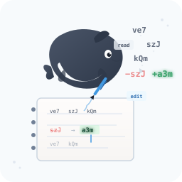
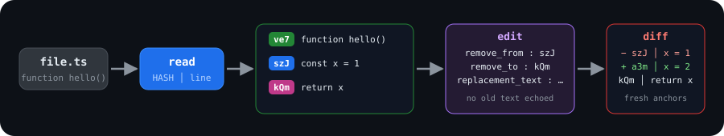

<p align="center">
  
</p>

<h1 align="center">dsh-better-edit</h1>

<p align="center">
  <strong>一个专为 DeepSeek Harness 而生的更好的编辑工具。<br>
  底层基于 hash-anchored 定位——不依赖行号，也不靠字符串替换，更少的词源消耗，留出更多的上下文空间给真正的工作。</strong>
</p>

<p align="center">
  <a href="README.md">English</a> ·
  <strong>简体中文</strong>
</p>

<p align="center">
  <a href="#快速开始">快速开始</a> •
  <a href="#为什么用-hashline">为什么用 Hashline</a> •
  <a href="#基准测试">基准测试</a> •
  <a href="#工具">工具</a> •
  <a href="#致谢">致谢</a>
</p>

<p align="center">
  
  
  
  
  
  
</p>

<p align="center">
  
</p>

---

> _"瓶颈在于 harness——而不是模型。"_
> —— Can Bölük，[_The Harness Problem_]
>
> **这是 harness 的修复。** 内容哈希取代行号——上方编辑永不使下方锚点移位。两个边界锚点都会对照 Agent 实际看到的内容校验。边界锚点过期或未解析被硬拒绝，回传当前锚点并记录为已提供，重试无需 `read`；边界仍然有效时，`hint` 允许跨过从未提供的内部行并在 diff 与警告中披露它，`strict` 则拒绝；不带行（或锚点与镜像冲突）的拒绝会指名一次 `read`。
>
> **3 次调用 vs 6 次 · -55.8% tokens · 23/23 正确性。** 同样的外部漂移重构，同样正确的文件（单次随机运行 vs OMP；[完整方法](https://github.com/Rianico/pi-better-edit/blob/main/benchmarks/results/2026-08-17-practical-token-benchmark.md)）。

大多数编辑工具要求模型在改动任何东西之前，先**逐 token** 复述旧代码——而这正是 Agent 最容易出错的地方：多个模型在 replace 式编辑下的补丁格式失败率高达 46–51%。**dsh-better-edit** 走得更远。文件的每一行都分配一个唯一的 3 字符内容哈希，编辑时按哈希定位。旧文本从不回显，锚点在编辑后依然有效，每个解析出的边界与已提供的行都会对照模型实际看到的已提供状态核对——错行编辑不可能悄悄落盘。

## 为什么需要它

`str_replace` 会让模型逐字复述它要替换的代码——纯粹的转录成本（输出 token，按约 5-6 倍输入计费），也是 Agent 最容易出错的地方：真实模型补丁失败率高达 46–51%，块越大越糟，每次失败都要重新读取并重试。

Hashline 用两个哈希代替旧文本——**编辑 token 减少 31%**（多行范围达 43%）——并对照模型所见内容校验每个范围：编辑要么落在你想要的行的位置，要么响亮失败并回传新锚点。锚点是内容地址，上方编辑后依然有效，连续编辑无需重读；上下文更精简，模型的注意力也保持在代码上，而不是复述上。

> [!TIP]
> **亮点——诚实且可衡量：**
>
> - **自愈而非静默。** 外部编辑永不被覆盖——过期范围被拒绝并以全新 `HASH│content` 重发重试；孤儿 served 条目无需全量重读即可自愈（ADR-0008）。Fail-closed，而非自动合并。
> - **格式化容忍（仅限边缘）。** 锚点由行的原始字节派生（行首与行尾的空白计入身份）；边缘空白的格式化容忍来自 canon 配对与租约，所以纯缩进变化和行尾空白清理能在 `prettier`/`black`/`eslint --fix` 之间存活（`formatOnSave`、监听、CI），只是锚点拼写随字节旋转。行内空白（含字符串字面量）显著，`"a b"` 与 `"ab"` 是两行——改写它会退役租约并 fail-closed 拒绝（ADR-0002，ADR-0040/ADR-0041 修订）。
> - **链式与批量，无重读仪式。** 未受影响行的锚点保持有效；diff 行与带行的拒绝行都记录为已提供，只有不带行的拒绝才指名一次 `read`。`edit` 最多 32 个同文件编辑原子执行（`[E_BATCH_ABORT]`），相比 `str_replace` 信封约 -40%。
> - **读守卫。** 两个边界锚点都必须在已提供状态中解析，但它们不证明模型看过中间的行——leased 路线上，仍然有效的边界可以授权跨过未提供的**内部**行（`hint` 会披露被替换的内部行，`spanMode: strict` 在写入前拒绝）。内部行重要时，请一次连续读取整个范围。
> - **更少往返。** 实测：同样外部漂移重构，OMP 封装需 6 次调用，hashline 仅 3 次；信封 vs `str_replace` 的节省是稳定值—— upstream 电池可复现（算法相同）。

不适用于单行小改动（接近持平）或新建文件（用 `write`）。它的价值在长会话与结构性编辑中体现——任何不允许改错行的场景。

## 快速开始

### 安装

```sh
npx @deepseek-ai/dsh plugin --profile web add github:Rianico/dsh-better-edit   # 从 github
npx @deepseek-ai/dsh plugin --profile web add dsh-better-edit   # 从 npm
npx @deepseek-ai/dsh plugin --profile web add /path/to/dsh-better-edit   # 从本地源码
```

该 profile 的下一个会话将带着 hashline 工具运行。验证该层是否生效：

```sh
dsh --profile <name> --dump-config   # 会显示 "# == dsh-better-edit" 层
```

| 要求    |                                                                       |
| ------- | --------------------------------------------------------------------- |
| Node    | `^22.19.0 \|\| >=24.0.0`（dsh 的要求；存储使用 `node:sqlite`）        |
| Profile | 一个 dsh profile（首次使用 `dsh plugin` 时初始化）                    |
| 后端    | 支持沙箱/远程文件系统（写入经 `ctx.fs`）                              |
| dsh     | `0.2.1-rc.2`（已端到端验证；`0.1.6-alpha.2` 是上一个 0.2 之前的基线） |

**支持 dsh 0.2.0 及以上。** 注册走 `agent/created`，路径解析跟随会话的**实时**工作目录（`workingDirectory`，0.2.1 之前回退到 session header），工具指引的 order 取自 `systemPrompt.getSectionOrder`。没有 peer 版本范围，也不做运行时版本探测：兼容性来自这层稳定接口加可选服务回退——缺少 `workingDirectory` 或 `agentPresets` 的组合同样可用。

`read` 返回的每一行都带有哈希前缀——哈希*就是*这一行的地址：

```text
ve7│function hello() {
szJ│  console.log("world");
kQm│}
```

`edit` 按哈希范围定位，因此编辑总能落在你想要的行的位置：

```json
{
  "path": "src/main.ts",
  "edits": [["szJ", "szJ", "  console.log('hi');"]]
}
```

并产生带全新锚点的 diff，让下一次编辑无需重新读取即可通过校验：

```text
− szJ │   console.log("world");
+ a3m │   console.log('hi');
  kQm │ }
```

在 `hint` 模式下，本会话从未提供的被删除行会渲染为空栏（`-   │content`）而不是锚点；折叠的删除会在 `[N lines deleted]` 标记后追加 ` (N unserved)`——diff 绝不交回会话无法兑现的锚点。

> 详见[快速开始](#快速开始)中[配置](#配置)一节的指引覆盖与存储租约。

### 配置

租约与提示词指引都只需声明一次，在 `agent/created` 时读取，无需改代码。

#### 存储租约 — 默认 central

默认无仓库污染。存储位于 `$DSH_HOME/plugins/dsh-better-edit/runtime/<name>-<hash8>/`（`central`）。

> [!NOTE]
> DB 文件是**可丢弃的缓存**——下次调用 `read` 时会自动重建（哈希值由文件内容重新推导）。可随时 `rm -rf` 任意 `runtime/<name>-<hash8>/` 或 `hash-store.sqlite*` 以回收磁盘；不会丢失用户数据（仅丢失锚点历史和撤销快照）。

如需回退到旧的同址或自定义根：

```yaml
# $DSH_HOME/plugins/dsh-better-edit/config.yaml
storeDir: central # 存储位置："central"（默认，位于 $DSH_HOME/.../runtime/<name>-<hash8>/）| "workspace"（旧版 <ws>/.dsh_better_edit/）| "/abs/path"（自定义根目录）
autoGitignore: false # 仅 workspace：当 .git 存在但 .gitignore 缺少 .dsh_better_edit/ 时，true = 自动追加 ".dsh_better_edit/"，false = 仅告警一次
spanMode: hint # hint | strict——strict 拒绝被替换却从未提供的内部行
eol: AUTO # 行尾：AUTO（沿用文件主导行尾）| LF | CRLF | CR
undo_ttl_s: 604800 # 撤销历史 TTL（秒）；-1 = 永久保留（默认 604800 = 7 天）
storeMaxAgeS: 2592000 # central 清理：runtime/<name>-<hash8>/ 目录最大闲置时长（秒），超时后被清理（默认 2592000 = 30 天）
storeMaxTotalBytes: 524288000 # central 清理：runtime/ 下总字节数上限，超限后按 LRU 清理（默认 524288000 = 500 MB)
```

> [!TIP]
> 若文件不存在，首次启动时会自动生成带注释的默认 `config.yaml`（永不覆盖已有文件）。

Env 覆盖 yaml（`env > yaml > central`），非法回退到 `central` 并告警：

```sh
DSH_BETTER_EDIT_STORE_DIR=central|workspace|/abs
DSH_BETTER_EDIT_AUTO_GITIGNORE=true|false  # 大小写不敏感
DSH_BETTER_EDIT_SPAN_MODE=hint|strict
DSH_BETTER_EDIT_EOL=AUTO|LF|CRLF|CR          # 大小写不敏感
```

`spanMode` 不提供按调用覆盖；策略归 profile 所有。详见 [ADR-0045](docs/adr/0045-strict-span-mode.md)。

**行尾。** 每次 `edit` 只写**一种**生效行尾：优先 `DSH_BETTER_EDIT_EOL`，其次上面配置里的 `eol`，其次文件的主导行尾（平局依次取 LF、CRLF、CR），最后才是系统行尾（Windows `\r\n`，其他 `\n`）。`AUTO` 沿用文件主导行尾，`LF`/`CRLF`/`CR` 强制指定。混合行尾的文件会在读取时说明——`[W_MIXED_EOL] Mixed EOL: 2 CRLF, 1 LF. All edits normalize to CRLF (file).`——而真正改写了行尾的编辑会报告 `[MODEL] [W_EOL_REWRITTEN] EOL normalized to CRLF (file): 1 terminators changed. Undo restores normalized content.`；`undo_last_edit` 在同一个生效行尾上恢复，并在编辑前是混合行尾时明确说明混合已无法还原。

**文件编码。** 一次 `read` 会记录文件的 `{encoding, hasBOM}`，而后续写入必须经过永远编码为 UTF-8 的纯文本通道复现这些字节。无法往返的旧文件（UTF-16，或含非 ASCII 内容的 `windows-1251`）因此以 `[E_ENCODING_UNWRITABLE]` 拒绝——不写任何字节，不做静默转码，已提供的锚点仍然描述磁盘上的字节。在 `$DSH_HOME/plugins/dsh-better-edit/config.yaml` 中以 `normalizeToUtf8: true`（`DSH_BETTER_EDIT_NORMALIZE_TO_UTF8=true`，默认 `false`）选择启用：下一次编辑把文件迁移到 UTF-8——这是单向门，应用结果以 `[W_ENCODING_MIGRATED]` 载明，撤销会指名但永不反转（`undo_last_edit` 以 UTF-8 恢复文本；编码及其 BOM 已丢失）。以 `read({ encoding })`（例如 `windows-1251`）在另一种编码下重新打开字节；`autoGuessEncoding` 门（`DSH_BETTER_EDIT_AUTO_GUESS_ENCODING`，默认 `false`）只在确定性的 BOM → 严格 UTF-8 检测失败后才自动解码：猜中的编码会随读取一并报告，置信度居中的猜测还会列出 Top-3 候选，而无法解码的文件则携带 Top-3 被拒绝，供模型挑选。猜测范围限于 `supportedEncodings`（`DSH_BETTER_EDIT_SUPPORTED_ENCODINGS`，默认 `gbk, big5, shift_jis, euc-kr, windows-1251, iso-8859-1`）；UTF-8 恒被接受，不在该名单之内——确定性的 BOM → 严格 UTF-8 通道先于任何猜测运行。挂着旧编码名的纯 ASCII 文件是字节忠实的，会静默编辑——它的字节本来就是 UTF-8。

旧的 `<workspace>/.dsh_better_edit/` 在首次以 central 打开时一次性拷贝；`runtime/<name>-<hash8>/` 可通过 `ls` 查看，带 `.wsPath` 旁路文件。工作区身份跟随会话的**实时**工作目录（`working_directory` 工具），而不是会话创建时的目录。生命周期详见 `docs/specs/issue-24-store-tenancy.md`（janitor `mtime>storeMaxAgeS` 后 LRU、WAL checkpoint、`undo` TTL）。

#### 按 preset 的指引

`tool:read` / `tool:edit` / `tool:undo_last_edit` 的提示词片段是按 agent preset 覆盖的纯 Markdown 文件，无需改插件：

```
$DSH_HOME/plugins/dsh-better-edit/<preset>/<section>.md
```

（默认主目录 `~/.dsh`，即 `~/.dsh/plugins/dsh-better-edit/`）。片段对照表：

| 文件                | 提示词片段            | 默认 order |
| ------------------- | --------------------- | ---------- |
| `read.md`           | `tool:read`           | 1100       |
| `edit.md`           | `tool:edit`           | 1300       |
| `undo_last_edit.md` | `tool:undo_last_edit` | 1310       |

首次启动时插件会为四个随附 preset——`standard/`、`ptc/`、`minimal/`、`cordis/`——各自写入编译内置的可编辑指引文件（含 `order` front-matter）。默认 order 取自 harness 自己的工具槽位（`systemPrompt.getSectionOrder`），上游调整 band 时会自动跟随；front-matter 可自行钉死。详见[配置详情](#按-preset-配置指引)的重置/恢复。完整规范：`docs/specs/issue-24-store-tenancy.md` 与指引文档。

##### 重置 / 恢复默认

**想让指引“回到默认”？删掉覆盖文件，或把它清空（同时删掉开头的 `---` 栅栏）即可。**

清空文件时，只要文件里是空白内容、并且没有 `---` 栅栏，插件就认为你不想再自定义这一片段了，于是：

- 新会话开始时，直接使用插件内置的默认指引；
- 下一次启动插件时，会用默认内容把这个文件重新生成。

再细致一点：

- **为什么要连栅栏一起删**：只要文件里还有 `---` 栅栏，哪怕是空的、什么内容也没有，插件都当成“你有意留空”，不会去动它。所以“故意留空”就保留栅栏；“恢复默认”就把栅栏和内容一起清掉。
- **栅栏写错了会怎样**：少了一个 `---`、`order` 不是数字、出现了不认识的键——只要栅栏格式不对，插件会直接忽略这个文件：仍然渲染默认指引，并在日志里提示是哪个文件、哪里写错了。你写的正文会原样留在磁盘上，方便改好后再用。
- **自带 preset 与自定义 preset**：插件自带的四个 preset（`standard`、`ptc`、`minimal`、`cordis`）会在下一次启动时自动补全空白文件；自定义 preset 里删除的覆盖文件不会自动出现（删了就当“没有这个文件”）。删掉某一整个 preset 目录，下次启动时插件会重新生成里面的三个片段文件（仅限自带 preset）。
- **恢复的是“当前版本”的默认**：插件升级后，重置得到的是新版本带的新默认内容，不是旧版本留下的。

文件的重新生成只发生在插件启动时，绝不影响进行中的会话。

## 为什么用 Hashline

**省 token。** 一次编辑调用只携带 `remove_from` / `remove_to`（两个 3 字符哈希）加替换文本——从不回显被替换的文本。`str_replace` 调用则必须逐字复现被替换的文本。在一个真实文件上的 12 次编辑会话中，这可以**减少 31% 的输出 token**（多行范围达 43%）——而且这些是*输出* token，按输入的约 5-6 倍计费。见[基准测试](#基准测试)。

**但这从来不是“最省 token”。** 节省随被替换文本的规模增长——单行微调时几乎持平——而且像 [@oh-my-pi/hashline](#对比) 这样的紧凑补丁语言还能发出更轻的负载（同一会话中 42–53%）。关键在于**正确形态**的编辑调用：不复述旧代码，模型除了两个稳定的内容地址外无需跟踪任何东西。

**正确性。** 解析出的编辑范围会与已提供状态核对：两个边界锚点必须仍然有效；边界有效时，`hint` 允许跨过从未提供的**内部**行（diff 用空栏、并以 `[W_UNSERVED_INTERIOR]` 披露），`strict` 则在**写入任何内容之前**拒绝该内部行。过期、歧义或未解析的范围会在写入前被硬性拒绝，并把当前范围以全新锚点的形式回显（reject-and-serve）——这些行会**记录为已提供**（行、canon、快照与租约，与对这些行做一次 `read` 等价），因此重试无需 `read`。两个例外如实说明：在同一调用中已有条目改动了临时缓冲区之后才发生的拒绝不显示任何行，只指名一次锚定读取会提供哪些当前文件行；若回显的锚点已被 served 镜像在别处占用，该窗口不予记录并在消息中说明。

**面向 Agent 的现代编辑范式。** 内容地址锚点与行号无关：编辑文件的一部分，其余行的哈希保持不变，因此连续编辑无需重新读取。模型按行**是什么**来定位，而不是按它之前在第几行。

**持久撤销。** `undo_last_edit` 在**生效行尾**（effective EOL）上以 UTF-8 恢复上一次编辑前的内容：BOM、原始锚点一并恢复，重启后依然有效。编辑前的**混合行尾不会被恢复**——撤销只写一种行尾，并在响应中说明这一事实；迁移过的旧编码文件恢复为 UTF-8 文本——撤销会指名被放弃的编码及其 BOM，但原始字节不再回来。

### 对比

|                                |     hashline `edit`     | `str_replace`（Claude Code / Codex） |         @oh-my-pi/hashline 补丁          |
| ------------------------------ | :---------------------: | :----------------------------------: | :--------------------------------------: |
| 调用中永不回显被替换文本       |     ✅ 只有两个哈希     |             ❌ 逐字回显              |              ✅ 只有 `+` 行              |
| 按什么定位行                   |        内容哈希         |               文本匹配               |           行号 + 文件内容标签            |
| 对照模型所见内容校验           |     ✅ 每一行已提供     |           ❌ 取第一个匹配            |               ~ 仅文件版本               |
| 检测文件已过期                 |   ✅ 拒绝并回传新锚点   |        ❌ 可能匹配到错误位置         |      ✅ 标签不匹配 → 拒绝或三方合并      |
| 上方编辑后锚点依然有效         |       ✅ 内容寻址       |             ✅ 基于内容              |           ❌ 重新编号 + 新标签           |
| 连续编辑无需重读               |   ✅ diff 提供新锚点    |                  ~                   |            ~ 从编辑响应取行号            |
| 文本重复时无歧义               |    ✅ 边界锚点需校验    |           ❌ 取第一个出现            |          ~ 按位置，行未逐行校验          |
| 错行编辑永远不会悄悄落盘       | ✅ 已提供的每一行都校验 |           ❌ 取第一个匹配            | ~ 原则上可能（标签只校验版本，不校验行） |
| 块操作 / 寄存器 / `MV` / `REM` |           ❌            |                  ❌                  |                    ✅                    |
| 一次变更一个文档               |     ❌ 每次一个调用     |           ❌ 每次一个调用            |             ✅ 多 hunk 补丁              |
| 运行时                         |     ✅ Node（dsh）      |                  —                   |                ⚠️ 仅 Bun                 |
| 撤销                           |        ✅ 持久化        |                  ❌                  |              ❌ 不在范围内               |

> `~` = 偶尔/不稳定。`@oh-my-pi/hashline` 是一种紧凑的行锚定补丁语言（[npm](https://www.npmjs.com/package/@oh-my-pi/hashline)、[仓库](https://github.com/can1357/oh-my-pi/tree/main/packages/hashline)）：`[path#tag]` 头把每个 hunk 绑定到全文件内容哈希，`PUT N.=M:` 按行号定位；每次编辑都会重新编号——下一次的行号与标签取自编辑响应或重新 `read`。

**不同的工作，同一条血脉。** 两者都源于 [harness-problem](https://stencil.so/blog/the-harness-problem) 的洞见：模型绝不该复述旧代码。`@oh-my-pi/hashline` 是**补丁语言库**——负载更轻（每次编辑省 42%，单个批量文档省 53%，见[基准测试](#基准测试)），支持语法块操作（`PUT N*:`）、寄存器、`REM`/`MV`、多 hunk 文档、可插拔文件系统（任何后端），以及标签过期时的会话感知三方合并恢复。本插件则是一对 **dsh 工具**：`read` 把 3 字符内容哈希交给模型，`edit` 取其中两个，并对照已提供状态校验解析出的边界与已提供的每一行——无需重新编号、无需重新取标签、错误锚点永远不可能落到错误的行，`undo_last_edit` 重启后依然有效。代价：每次编辑的 JSON 外壳会多一点负载、没有块操作，并且它活在 dsh（Node）内部，而不是独立补丁器（Bun）。要跨后端的补丁格式选 hashline 库；要在 Agent 里做可校验、内容寻址的编辑，选 hashline 工具。

### 边界情况下的正确性

token 基准测试衡量的是模型发出的负载——它假设模型每次都能拿到**正确**的地址，而且免费。正确性才是两种 hashline 实现真正分道扬镳的地方。下面是 harness-problem 文献里的真实故障模式（错行编辑、漂移、重复文本），以及各自在遭遇它们时的表现：

| 边界情况                     | hashline `edit`（本插件）                                                                                | @oh-my-pi/hashline 补丁                                                                    |
| ---------------------------- | -------------------------------------------------------------------------------------------------------- | ------------------------------------------------------------------------------------------ |
| 错误地址（锚点/行号差一行）  | **不可能**——锚点解析到具体行；解析出的边界与已提供的行都对照已提供状态校验，在**写入任何内容之前**被拒绝 | **可能**——当前标签下的错误行号会**悄悄**落到错误位置；标签只证明文件版本，从不证明行       |
| 模型查看后文件在磁盘上被改动 | 硬拒绝 + 回传新锚点并记录为已提供（reject-and-serve）；重试无需 `read`；不带行的拒绝会指名 `read`        | 标签不匹配 → 拒绝**或**对未知的当前内容做尽力而为的三方合并                                |
| 上方编辑导致文件移位         | 什么都不移位——锚点是内容地址；diff 提供新锚点                                                            | **每次编辑都重新编号**——“RE-GROUND AFTER EVERY EDIT” 是它自己的头号规则；账由模型记        |
| 重复/相同文本                | 每行哈希唯一（冲突已消解）；歧义 → `[E_STALE_ANCHOR]`                                                    | 基于位置，重复不会混淆——但位置本身未被校验                                                 |
| 从未展示给模型的行           | 边界锚点未提供 → `[E_UNSERVED_RANGE]` 硬拒绝；内部行在 `hint` 下接受并在 diff/警告中披露，`strict` 拒绝  | 未展示的 hunk 被拒绝——同样依赖模型知道自己看过什么                                         |
| 表达式中间 / 错误的块节点    | 无关——任何已校验的行范围都合法                                                                           | 语法规则 + `PUT N*:` 节点选择；点错（锚在 `def` 会让装饰器变成孤儿）会悄悄落错；无语法检查 |
| 多编辑批量中途失败           | `edit` 多条目——原子、全有或全无；失败项以新锚点回显                                                      | 多段补丁先预检——同样原子                                                                   |

> oh-my-pi 42–53% 的负载节省来自更轻的线格式；上表才是该格式反过来要求模型记在脑中的东西——重新编号、追标签、选节点——而这恰恰是最容易出错的组件（替换式编辑的补丁失败率 46–51%）。本插件 31% 的代价买来的是一个“错编辑落不了地、带行的拒绝都不需要重读；不带行的拒绝会指名一次 `read`”的契约。

## 基准测试

在同一份 103 行文件上、用相同的 12 组替换（8 个单行、4 个 3/6/10/15 行多行），以固定的 `js-tiktoken` `cl100k_base` 词表测量。三个被测方发出相同的替换文本：本插件的 `edit`（两个 3 字符锚点）、`str_replace` 工具（逐字回显旧文本）、以及 [`@oh-my-pi/hashline`](https://www.npmjs.com/package/@oh-my-pi/hashline) 的两种模式——每次编辑一个 `[path#tag]` 段（`seq`）和一个多 hunk 批量文档（`batch`）：

| 指标                         |        hashline        |   str_replace   |    oh-my-pi seq / batch     |
| ---------------------------- | :--------------------: | :-------------: | :-------------------------: |
| 被替换文本是否上线           |        ✅ 从不         | ❌ 每次编辑都发 |           ✅ 从不           |
| 输出 token 节省（12 次编辑） |       ✅ **31%**       |      ❌ 0%      |      ✅ **42% / 53%**       |
| 多行范围节省（3–15 行）      |     ✅ **29–47%**      |      ❌ 0%      |        ✅ **40–53%**        |
| 按 5 倍输出计价的实际成本    |   ✅ **低约 1.4 倍**   |      ❌ 1×      | ✅ **低约 1.7 倍 / 2.1 倍** |
| 范围对照已提供状态校验       |        ✅ 100%         |      ❌ 无      |        ~ 仅文件版本         |
| 模型需要跟踪的行号           |    ✅ 无——内容锚点     | ✅ 无——文本匹配 |     ❌ 每次编辑重新编号     |
| 确定性、可在本地复现         | ✅ `npm run benchmark` |        —        |              —              |

### 可复现

上面的数字**是确定性的，你可以本地复现**——`npm run benchmark`：

| 场景         | 行数 | hashline | str_replace | oh-my-pi seq | oh-my-pi batch |
| ------------ | :--: | :------: | :---------: | :----------: | :------------: |
| 单行 ×8      |  1   |   309    |     324     |     241      |       —        |
| 多行 ×4      | 3–15 |   393    |     691     |     349      |       —        |
| **合计 ×12** |      | **702**  |  **1015**   |   **590**    |    **480**     |

相对 `str_replace` 的节省：hashline **313（31%）** · oh-my-pi 逐次 **425（42%）** · oh-my-pi 批量 **535（53%）**。

脚本天然确定：固定语料、内容寻址且自带自检的编辑脚本（语料被重排会直接抛错，而不是悄悄改变测量对象）、固定版本的 tokenizer，且 oh-my-pi 负载在计数前会对照其发布的语法校验。因为一切都是固定的，`npm run benchmark` 对每个人都是同一个结果——本 README 里的数字就是该次运行的一个快照；重新生成，不要轻信。

> **范围与诚实。** 基准测试衡量的是**请求负载 token**——每次编辑调用时模型发出的内容——读文件流量完全相同故已排除（可抵消），替换文本也完全一致。它**没有**建模转录失败与重试，而真实差距恰恰主要在那边：最初的 [harness-problem](https://stencil.so/blog/the-harness-problem) 文章报告改用锚定编辑后**输出 token 减少 61%**，补丁失败率从 46–51% 降至接近零。它同样**没有**建模行号格式在调用**之间**让模型付出的代价——每次编辑后重新编号、重新获取文件标签——也不包括块操作能力、Bun 与 Node 的运行时差异，以及 `@oh-my-pi/hashline` 是独立补丁器、而本插件是带 `read`/`edit`/`undo` 的 dsh 工具对这一事实。完整方法论、逐编辑表与完整局限清单见 [`benchmark/README.md`](benchmark/README.md)。这些数字背后的正确性差距见上文[边界情况下的正确性](#边界情况下的正确性)。

## 工具

| 工具             | 作用                                                                                                                                                                                                                                                                                                 |
| ---------------- | ---------------------------------------------------------------------------------------------------------------------------------------------------------------------------------------------------------------------------------------------------------------------------------------------------- |
| `read`           | 以 `HASH│内容` 形式返回文件。参数：`offset`（1 起始）、`limit`。分页输出以 `[Showing lines N-M of T. Use offset=… to continue.]` 结尾。超过 200KB 的行显示为标记并附 `sed` 提示——哈希锚点需要完整行。                                                                                                |
| `edit`           | `{file, edits:[[from,to,text]]}`（也接受命名对象；`path`/`file_path` 别名会被折叠），`""` 删除，原子 ≤32，先校验后写入。单条目编辑一个范围；多条目对同一文件原子批量（最多 32）。对每个包含范围内已提供的每一行校验，reject-and-serve 返回新锚点。                                                   |
| `undo_last_edit` | `{ path }` 撤销该文件上一次 hashline 编辑：在**生效行尾**上以 UTF-8 恢复编辑前的内容（连同 BOM 与原始锚点），仅当文件仍与存储的编辑后内容一致时生效；若编辑前是混合行尾，响应会说明混合未被还原；若编辑迁移了旧编码，恢复为 UTF-8 文本并指名被放弃的编码与 BOM（原始字节不再回来）；重启后依然有效。 |

内置 `write` 仍用于整文件替换。执行前，插件只会在候选行以同一会话、规范路径及行位置所提供的精确 `HASH│` 锚点开头时拒绝；文件保持不变，并提示仅用文件正文重试。插件不会泛化地剥离类似哈希的文本。

### 错误码

| 代码                      | 含义                                                             | 处理方式                                                                                                               |
| ------------------------- | ---------------------------------------------------------------- | ---------------------------------------------------------------------------------------------------------------------- |
| `[E_BAD_PAYLOAD]`         | 请求形态错误（未知字段、缺少 `file`、元组位置错误）              | 修正形态后重发                                                                                                         |
| `[E_MALFORMED_ANCHOR]`    | 锚点不是裸 3 字符锚点（粘贴的块或伪锚点）                        | 传裸锚点后重试                                                                                                         |
| `[E_UNKNOWN_ANCHOR]`      | 该锚点从未为本文件提供过                                         | `read` 获取新锚点                                                                                                      |
| `[E_FOREIGN_ANCHOR]`      | 该锚点属于其他文件或会话                                         | 使用本文件提供的锚点                                                                                                   |
| `[E_STALE_ANCHOR]`        | 锚点已无法解析（哈希/已退役/规范化失配）                         | `read` 获取新锚点                                                                                                      |
| `[E_AMBIGUOUS_MATCH]`     | `str_replace` 的 `old_str` 命中多处                              | 扩大 `old_str` 上下文                                                                                                  |
| `[E_NO_MATCH]`            | `str_replace` 的 `old_str` 不存在                                | 重新 `view` 后重试                                                                                                     |
| `[E_EMPTY_RANGE]`         | 编辑会清空非空文件                                               | 改用 `write`                                                                                                           |
| `[E_STALE_RANGE]`         | 已提供的范围在磁盘上发生变化                                     | 使用回显的新行（已记录为提供）；不带行的拒绝会指名 `read`                                                              |
| `[E_UNSERVED_RANGE]`      | 边界锚点从未解析，或 `strict` 下被替换的范围包含从未提供的内部行 | `hint`：使用回显的行（已记录为提供），不带行时指名 `read`。`strict`：不带行的拒绝会给出未提供文件行的编号，`read` 它们 |
| `[E_UNVERIFIED_RANGE]`    | 边界锚点无法对照已提供状态校验                                   | `read` 后重试                                                                                                          |
| `[E_SUSPICIOUS_TEXT]`     | 替换文本含复制的 `HASH│` 或 diff 预览标记                        | 移除后重发                                                                                                             |
| `[E_BLIND_REPLACE]`       | `write` / `str_replace_editor` 在观察文件前执行                  | 先 `read` / `view`                                                                                                     |
| `[E_TARGET_LOST]`         | 目标在操作中途消失或身份改变                                     | `read` 后重新定位                                                                                                      |
| `[E_BATCH_ABORT]`         | 批次中某项失败，未写入任何内容                                   | 修正该项后重发批次                                                                                                     |
| `[E_NOOP_LOOP]`           | 同一空操作编辑被反复提交                                         | 修改编辑内容                                                                                                           |
| `[E_ACCESS]`              | 路径不可读或不可写                                               | 修正权限                                                                                                               |
| `[E_NOT_FOUND]`           | 文件不存在                                                       | 检查父目录                                                                                                             |
| `[E_FILE_EXISTS]`         | `create` 目标已存在                                              | 换一个路径                                                                                                             |
| `[E_UNSUPPORTED_FILE]`    | 目录、二进制或非文本文件                                         | 选择文本文件                                                                                                           |
| `[E_ENCODING_UNWRITABLE]` | 记录的编码无法由 UTF-8 文本写入复现                              | 设 `normalizeToUtf8: true` 迁移，或在插件外编辑                                                                        |
| `[E_UNSUPPORTED]`         | `str_replace_editor undo_edit` 未实现                            | 改用 `undo_last_edit`                                                                                                  |
| `[E_BAD_COMMAND]`         | 未知的 `str_replace_editor` 命令                                 | 使用 `view`、`str_replace`、`insert` 或 `create`                                                                       |
| `[E_LARGE_FILE]`          | 超过行数或锚点空间上限                                           | 改用 `write` 或拆分文件                                                                                                |
| `[E_UNDO_STALE]`          | 编辑之后文件被修改                                               | 无法撤销；重新读取                                                                                                     |
| `[E_UNDO_UNAVAILABLE]`    | 撤销历史无法持久化                                               | 重试编辑                                                                                                               |
| `[E_UNDO_NOT_RECORDED]`   | 回滚已落盘但存储未能记录                                         | 重新读取；下次撤销会清掉旧历史                                                                                         |
| `[E_STORE_NEWER_VERSION]` | 存储由更新版本的插件写入                                         | 升级插件，或改用其他存储目录                                                                                           |
| `[E_UNKNOWN]`             | 未预期的内部错误                                                 | 上报；消息原文保留                                                                                                     |

### 警告码

| 代码                    | 含义                                                                 | 处理方式                                                                                   |
| ----------------------- | -------------------------------------------------------------------- | ------------------------------------------------------------------------------------------ |
| `[W_UNSERVED_INTERIOR]` | `hint` 模式应用了一次编辑，其替换范围包含本会话从未提供的内部行      | 确认这次未经检视的替换符合意图；`spanMode: strict` 会改为拒绝                              |
| `[W_EOL_REWRITTEN]`     | 一次编辑在同一个生效行尾上重写了文件的行尾                           | `undo_last_edit` 恢复规范化后的内容；强制档连均匀文件也会重写                              |
| `[W_MIXED_EOL]`         | 一次读取提供了混合行尾的文件（无受众：读取只报告状态，不寻址任何人） | 无需处理；下一次编辑会规范化到指名的行尾                                                   |
| `[W_ENCODING_MIGRATED]` | 一次编辑在 `normalizeToUtf8: true` 下把旧编码文件迁移到了 UTF-8      | `undo_last_edit` 只恢复文本；编辑前的编码与 BOM 已丢失——只有版本控制或外部重编码能恢复字节 |

警告属于 applied 层通知：编辑已落地且文件有效；文本指出未被检视的内容。唯一的读取层代码仅为完整起见列出，不设受众——读取只报告所见状态，没有写入任何内容。

## 如何替换内置工具

dsh 的工具注册表按作用域解析：agent 看到的是 `agent → preset → global`，且**自身**层总是优先。内置的 `read`/`edit` 位于 agent-preset 层，因此普通的全局注册无法替换它们。本插件：

1. 通过其 `cordis.patch.yml` bundle 补丁作为宿主层 Cordis 插件挂载。
2. 在 `agent/created` 时，将 hashline 工具**以及** `tool:read` / `tool:edit` 提示词片段注册到 agent 自身的作用域层——从而为该 agent 遮蔽 preset 的内置工具，并在 agent 销毁时自动解除。
3. 保留内置的 `write`，通过作用域内的 `tools/pre-execute` 监听器在执行前拒绝精确的同会话/同路径/同行锚点回显，并由 `tools/post-execute` 在成功结果后附加 hashline 自动读取。

## 存储

哈希快照、已提供状态行与撤销历史存放在一个 SQLite 库中——**默认 central**（`$DSH_HOME/plugins/dsh-better-edit/runtime/<name>-<hash8>/hash-store.sqlite`，可通过 `ls` 查看，带 `.wsPath` 旁路文件）。旧的同址 `<workspace>/.dsh_better_edit/` 仍可通过 `config.yaml` 中 `storeDir: workspace` 启用，并在首次以 central 打开时一次性拷贝。不同工作区的并行会话各自持有独立的库（会话 cwd 会随每次工具调用传递），因此一个项目的锚点与撤销历史不会泄漏到另一个项目。在工具调用之外（测试、预览）会回退到共享的 DeepSeek Harness 主目录（`$DSH_HOME/plugins/dsh-better-edit/hash-store.sqlite`）。

7 天 TTL 清理已提供的行；`undo_ttl_s`（默认 7 天，`-1` 永久）清理撤销副本；缺失文件的快照在受控的 `openStore` 中清理；损坏的库会被隔离并自动重建。 central 的 janitor（`apply` + `agent/created` 受控节流 >24h）会先清理 `mtime>storeMaxAgeS`（默认 2592000 秒 = 30 天），再按 LRU 至 `count<100 && sum<500MB`，永不删除存活的 `hash(workspaceCwd)`，并在关闭时执行 `wal_checkpoint(TRUNCATE)`。DB 文件为可丢弃缓存——可安全删除，下次 `read` 时重建。

## 项目结构

```
dsh-better-edit/
├── src/
│   ├── hashline/        # 哈希 + 已提供状态核心（从 pi-hashline-edit-lsz 逐字节移植）
│   ├── tool-read.ts     # read  — HASH│内容、offset/limit 分页
│   ├── tool-edit.ts     # edit  — 按哈希范围、reject-and-serve
│   ├── tool-batch-edit.ts
│   ├── tool-undo.ts     # undo_last_edit
│   ├── sandbox.ts       # FsSandboxController 镜像（sandbox_permissions/justification）
│   ├── write-hook.ts    # 附加到 write 结果的自动读取
│   ├── served-store.ts  # 按工作区的 SQLite 存储（node:sqlite）
│   └── workspace.ts     # 会话 cwd 的 AsyncLocalStorage 载体
├── benchmark/           # 可复现的 hashline、str_replace 与 oh-my-pi token 基准测试
│   └── corpus/          # 固定的 103 行语料
├── test/                # 615 个测试（移植 + 回归）
├── assets/              # logo 与 banner
├── cordis.patch.yml     # bundle 补丁
└── package.json         # dsh.bundle manifest
```

## 开发

```sh
npm install
npm run typecheck   # tsc --noEmit
npm test            # vitest run（615 个测试）
npm run build       # tsc → lib/
npm run benchmark   # 可复现的 token 成本基准测试（benchmark/）
```

### 发布流程（先打 tag）

```sh
npm run release -- 0.2.0                 # 升版本 + 迁移 CHANGELOG + 提交 + 打 tag + 推送 → 生成 GitHub release
npm publish --registry https://registry.npmjs.org   # 版本未打 tag 前会被阻止
```

`npm run release` 会更新 `package.json`/lockfile、把 CHANGELOG 的 `[Unreleased]` 段落迁移到版本号下、提交、打 `vX.Y.Z` tag 并推送——tag 推送会基于 changelog 自动创建 GitHub release。`npm publish` 在该 tag 存在之前会拒绝运行（prepublishOnly 门禁），因此每个 npm 版本都一定已经打好 tag 并发布过 release。

测试套件移植自 pi-hashline-edit-lsz，通过本地文件系统桥接直接驱动 dsh 工具构建器。

## 路线图

**当前状态（1.0.0）：** v2 行身份架构、按会话 `(session,path)` 存储、1648 个测试、中英双语 README、dsh `0.2.1-rc.2`。

<details><summary>下一步</summary>

- **缩小或证明与 @oh-my-pi/hashline 的差距**（参考：[`../oh-my-pi.md`](../oh-my-pi.md)）。这个兄弟补丁语言负载更轻——基准测试中相对 `str_replace` 省 42%/53%，而我们省 31%，因为它裸文本式的补丁文档跳过了我们每次调用都要付的 JSON 外壳——还提供了我们不支持的四种能力：语法块操作（`PUT N*:`）、寄存器 + `REM`/`MV`、一次变更一个多 hunk 文档、可插拔文件系统。代价在正确性一侧：它的行号未经验证（当前标签下的错行号会静默落盘）、每次编辑都要重新编号、过期标签触发尽力而为的三方合并而非校验、语法也抬高了模型的技能门槛。逐项决定是拒绝还是采纳——负载差距本身不足以成为切换格式的理由。
- 在 dsh 会话中实测 1.0.0（0.2.1-rc.2 运行时）。
- 把 served-tail 截断修复回馈给 pi-hashline-edit-lsz / 上游（他们的 `upsertServed` 同样从不截断）。
- 对照下一个 dsh 版本重新核对插件接线（当前固定在 `0.2.1-rc.2`；dsh 处于开发者预览阶段，承诺会有破坏性变更）。

</details>

## 贡献

见 [CONTRIBUTING.md](CONTRIBUTING.md)（或者直接开 [issue](https://github.com/Rianico/dsh-better-edit/issues)）。当前最有价值的贡献是更多基准场景和针对已提供状态校验的边界测试。

## 许可证

MIT License——详见 [LICENSE](LICENSE)。移植自 pi-hashline-edit-lsz（MIT），其本身带有 RimuruW 与 YuGiMob 的上游版权声明。

## 致谢

哈希锚定编辑源于 Can Bölük 的 [_The Harness Problem_](https://stencil.so/blog/the-harness-problem)——那篇文章证明了瓶颈在于 harness 而非模型，并证明锚定编辑优于搜索替换。本项目站在以下巨人的肩膀上：

- [**pi-hashline-edit**](https://github.com/RimuruW/pi-hashline-edit)（RimuruW）——引入 3 字符哈希与冲突消解的原创 pi-coding-agent 扩展。
- [**pi-hashline-edit-pro**](https://github.com/YuGiMob/pi-hashline-edit-pro)（YuGiMob）——本仓库 hashline 核心所移植自的加固版 fork。
- [**pi-hashline-edit-lsz**](https://github.com/Rianico/pi-hashline-edit-lsz)——本项目所跟随的自维护 fork。hashline 核心逐字节移植；工具层基于 dsh 的插件 API 重写。

延伸阅读：[Hash anchors + Myers diff + single-token anchors（dirac.run）](https://dirac.run/posts/hash-anchors-myers-diff-single-token)（关于编辑调用 O(S+R) → O(R) 节省的设计评论）以及一个独立的 [hashline 与 replace 对比基准测试](https://nwyin.com/blogs/hashline-vs-replace-edit-bench.html)。

---

## Star History

[](https://star-history.com/#Rianico/dsh-better-edit&Date)

---

<p align="center">
  <strong>⭐ 如果 hashline 编辑让 Agent 的编辑更可靠，就给它一个 star 吧！</strong>
</p>
