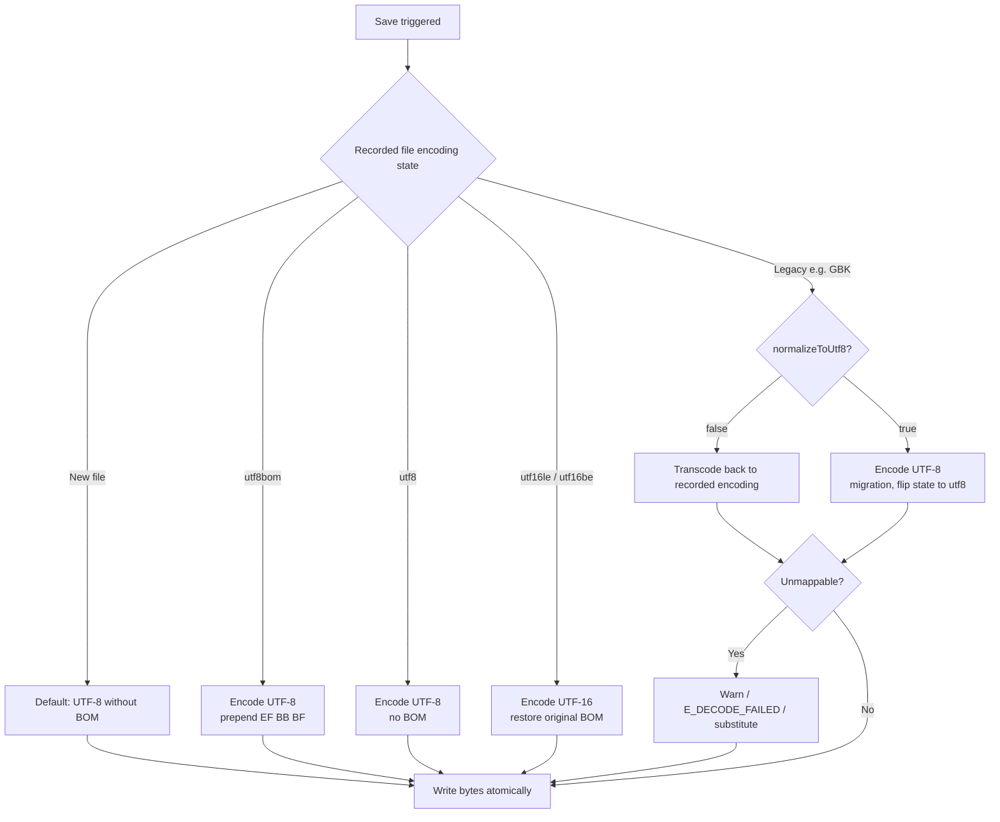

# ADR-0012 — VS Code Encoding Model for Non-UTF-8 Text

Date: 2026-08-30
Status: accepted (grill-with-docs, Q1–Q12). Amended 2026-11-16 (#112): the write seam is text-only, so the save side refuses a non-round-trippable encoding instead of transcoding. Amended 2026-11-25 (#209): migration is a per-call consent with a UTF-8/BOM target enum; see ADR-0052.
Related: #34 `read/edit reject non-UTF-8 text files`, `docs/specs/issue-34-encoding-research.md`, GLOSSARY.md `File Encoding`

## Context

`read/edit` on GBK/CP1251/Shift-JIS fails with `[E_NOT_TEXT] Path is not a readable UTF-8 text file` — the file is text, just not UTF-8. `ctxFsIO.readText` forwards DSH `FS_NOT_TEXT` (provider's `TextDecoder("utf-8",{fatal:true})` + NUL-sample gate) with no hint, while `localIO` permissively shows `�` and normalizes. DSH `dsh-fs` is `0.1.0-rc.6` (developer preview, breaking changes allowed) and text-only by contract (`Binary-safe mutations remain deferred`).

The proposal: adopt VS Code's flow — deterministic-first detection, state-at-open / invert-at-save round-trip, manual override, off-by-default guessing — adapted for the harness's agent tool surface.

## Decision

Adopt the VS Code model verbatim, with 3 harness deltas: model-assisted guessing instead of `jschardet`, top-3 scored previews, and `read_skill` encoding-without-served semantics.

### Read flow

```mermaid
flowchart TD
    A[Read raw bytes via readBytes] --> B{BOM?}
    B -->|EF BB BF| C[utf8bom]
    B -->|FF FE| D[utf16le]
    B -->|FE FF| E[utf16be]
    B -->|no BOM| F{strict UTF-8 fatal:true}
    F -->|valid| G[utf8]
    F -->|invalid| H{autoGuessEncoding?}
    H -->|false| I[E_NOT_TEXT + Top-3 guesses<br/>+ hint + manual read encoding]
    H -->|true| J[score allowlist via chardet+iconv-lite<br/>printable + scriptRange + confidence]
    J --> K[top-3 previews (chardet Top-3 when conf>=45 else heuristic Top-3)<br/>50-char smart slice, always pushed]
    K --> L[model picks encoding]
    L --> M[read encoding canonical]
    C --> Z[record file encoding state<br/>targetKey→encoding,hasBOM,version]
    D --> Z
    E --> Z
    G --> Z
    I --> Z
    M --> Z
    Z --> N[hash internal UTF-8 view<br/>serve HASH│content]
```

_Deterministic-first:_ BOM sniff always precedes strict UTF-8, which always precedes guessing. Probabilities are last resort, gated by `autoGuessEncoding` (default `false`, mirrors VS Code) for **auto-decode**, but **Top-3 candidates are always pushed** — as `E_NOT_TEXT` details when `autoGuessEncoding:false` and as `[Auto-guessed: enc, candidates: …]` second `ContentBlock` footer when `true` (probabilistic encodings always surfaced, never hidden).

_Model-assisted top-3 (chardet + heuristic):_ Always run `chardet` (maintained, MIT, 22KB) as Top-3 enhancer; `autoGuessEncoding:true` auto-decodes via `chardet` Top-1 when `confidence>=45`, otherwise heuristic (`iconv-lite` score without `�` + printable + script-range + cjk*5/hiragana*8). Top-3 (50-char smart slice around first non-ASCII, ~36 tokens) is **always surfaced** — in `E_NOT_TEXT` (`Top-3 guesses: … Try read({encoding})`) or in the auto-guess footer (`[Auto-guessed: enc conf, candidates: …]`). The model re-calls `read({encoding})` from that list only; `encoding` is canonical case-insensitive enum (`utf8`/`gbk`/`cp1251→windows-1251`, hyphens/underscores stripped). Missing `config.yaml` keys are complemented with defaults on next `loadConfig()` (see `store-config.ts` complement).

### Write flow



> **Superseded by the #112 amendment below:** the `utf16le/utf16be → Encode UTF-16` and `Legacy → Transcode back` arms are not expressible over the harness filesystem (the only write is `writeText(target, content: string, …)`, which encodes UTF-8). Those two arms are replaced by the typed `E_ENCODING_UNWRITABLE` refusal before any write.

_State at open, invert at save:_ `file encoding state` `{encoding, hasBOM, lineEnding}` is recorded at open and inverted on save — never re-derived. Drift-aware: if `stat.version` changed, discard stale `file encoding state` and re-run deterministic `BOM→UTF-8` before any guess. Session-TTL (like `served state`), not cross-restart.

_Defaults favor modern convention:_ New files `utf8` without BOM; BOM only ever preserved, never added spontaneously. Failure explicit — undecodable/mojibake surfaces as `E_NOT_TEXT`/`E_DECODE_FAILED` or `details.candidates` warning, never silent rewrite.

### Tool surface vs VS Code

| VS Code                                                    | BetterEdit                                                                                  | Delta                                               |
| ---------------------------------------------------------- | ------------------------------------------------------------------------------------------- | --------------------------------------------------- |
| `files.autoGuessEncoding` off                              | `autoGuessEncoding: false` + `DSH_BETTER_EDIT_AUTO_GUESS_ENCODING`                          | Verbatim, flat bool in `store-config.ts`            |
| Status bar + `Reopen with Encoding` / `Save with Encoding` | `read({encoding?})` + `write({encoding?})` (canonical enum, `E_BAD_ENCODING` on unknown)    | Agent has no status bar — tool params are the hatch |
| `jschardet` probability                                    | heuristic score + model picks from top-3                                                    | No 200 KiB dep, agent aligns with visible mojibake  |
| Buffer is owner                                            | DSH provider owns when available; else plugin `Map<targetKey,…>` invalidated by `FsVersion` | Hybrid per Q1                                       |

`read_skill` (reference read) follows the same capture path for encoding (so GBK `SKILL.md` renders), **records `file encoding state` but never `served state`** — it can feed `write` (full replace, round-trips when `normalizeToUtf8:false`) but cannot authorize `edit` anchors (`E_RANGE_UNSERVED` still requires a hashed `read`).

Errors: `E_NOT_TEXT` (initial, with `candidates` when guessing), `E_BAD_ENCODING` (unknown `encoding` param), `E_DECODE_FAILED` (bytes undecodable under requested charset).

## Considered Options

- **Plugin-local `readBytes+jschardet+re-encode` shim (#34 as-written)** — rejected as system seam ownership violation; duplicates `file-type`/NUL/`maxBytes` guard, 200 KiB + false positives on <1 KiB, diverges `dsh read` vs `better-edit read`, needs version-persisted `Map`.
- **DSH provider blindly normalizes to UTF-8** — rejected for GBK-locked repos (one-way migration without `normalizeToUtf8` opt-in).
- **Hardcoded 5 encodings + 200-char previews** — superseded by configurable allowlist + 50-char smart slice + scoring (your Q7 probe).
- **`read_skill` strict UTF-8 only** — superseded by your Q12 follow-up: capture encoding too, just never serve.

## Consequences

- `GLOSSARY.md` adds `### File Encoding` glossary: `file encoding state`, `decoding error`≠`detection error`, `autoGuessEncoding`, `manual override`; refines `read_skill`.
- `src/store-config.ts` adds `autoGuessEncoding: false`, `normalizeToUtf8: false`, `supportedEncodings?: string[]` (flat) + env adapters + `DEFAULT_CONFIG_YAML` docs; `loadConfig()` `mtimeMs` cache extended.
- `src/encoding.ts` (new, pure) + `src/fs-bridge.ts` fallback `Map` + `tool-read.ts`/`tool-write.ts` `encoding` params follow in implementation PRs.
- `FsWriteOutcome.before` becomes `string` (not `null`) for permissively decoded legacy files; large legacy files (`>readBytes maxBytes` ~10 MiB) still `E_FILE_TOO_LARGE` v1.
- Upstream proposal: enrich `FS_NOT_TEXT` `cause` + permissive `readWholeText` normalization — complementary, not blocking.

## Amendment (#112, 2026-11-16) — the write seam is text-only, so the save side refuses instead of transcoding

**Status note.** The write-flow diagram above (arms `utf16le/utf16be → Encode UTF-16 restore original BOM` and `Legacy → normalizeToUtf8:false → Transcode back to recorded encoding`) described an intent the harness filesystem cannot express. This amendment records the real seam and replaces those two arms with the fail-safe refusal. Everything about the READ flow stands.

### The seam: there is no byte-write

- The only write the deployment exposes to this plugin is `writeText(target, content: string, …)` (`src/fs-bridge.ts` `FileIO.writeText`; dsh `ctx.fs.writeText` / `editText`). Every backend — including `dsh-fs-local` — encodes that string as **UTF-8**. There is no `writeBytes` primitive, and writing bytes out of band (`node:fs`) would bypass the sandbox policy, the `fs/write-intent` guard, the `fs/observed` event, and remote/sandboxed backends. That bypass is not an option; it is the reason the seam is narrow.
- Consequence: a UTF-16/UTF-32 image and a non-ASCII single-byte image (GBK, windows-1251, Shift-JIS, …) **cannot be reproduced** by a text write. Before #112 the save side pretended otherwise: the legacy arm returned a UTF-8 string, the provider wrote it, the memo still said `utf16le`, and the next read silently re-detected UTF-8 — a silent transcode.
- `prepareForSave` (`src/file-encoding-state.ts`) is the single save decision. It now returns one of three verdicts:
  1. **utf8 / utf8bom** — restore the recorded BOM + line ending and write; unchanged behaviour.
  2. **any other recorded encoding, byte-faithful** — `isByteFaithfulAsUtf8(text, encoding)` proves the UTF-8 byte image equals the image under the recorded encoding (an ASCII-only file recorded as `windows-1251`, or empty content). The write is byte-identical, so it is allowed; the memo becomes `utf8` because that is what the bytes now are.
  3. **any other recorded encoding, not byte-faithful** — refuse **before any write**.
- Narrowness is decided by **bytes, not the encoding name**: an ASCII-only file recorded as `cp1251` stays editable, while `utf16le` of the same text does not (its byte image differs).

### The refusal

`E_ENCODING_UNWRITABLE` (new member of the shared vocabulary in `src/domain-errors.ts`, MODEL audience). It is deliberately **not** `E_STALE_ANCHOR` and **not** `E_UNSUPPORTED_FILE`: the read succeeded and the anchors are valid — only the write is impossible. Its rendered text names the limitation (the filesystem exposes only a text write that always encodes UTF-8; writing would transcode silently) and the remedy (#210 rewrote it to name the `allow_encoding_migration` payload value and the standing `allowEncodingMigration` setting; the legacy `normalizeToUtf8: true` spelling is still honoured — see ADR-0052). Nothing is written; for a batch the verdict is computed for every file before the first write, so a multi-file edit never leaves one file transcoded and the next refused.

### `normalizeToUtf8: true` keeps its meaning

The explicit migration is the only way a non-UTF-8 file becomes writable: write UTF-8, drop the legacy BOM, and record `{ encoding: "utf8", hasBOM: false }` so the next read agrees with the bytes. Defaults and auto-guess are untouched (still `false`; ADR unchanged on that point).

### Mutating reads consume the recorded encoding

`read({ encoding })` serves anchors for the decoded text, so every re-read that feeds a mutation must decode the same way: `edit` (`src/mutation/engine.ts` `runFileEdits`), `str_replace_editor` (`src/tool-str-replace-editor.ts`), and the `undo_last_edit` staleness check (`src/tool-undo.ts`) pass `encodingHintAtVersion(...)` as the bridge's decode hint. The helper drops a memo whose `version` no longer matches the file, so a drifted file is re-detected rather than having the old encoding laundered onto new bytes; `utf8`/`utf8bom` are not hinted because the plain path already reproduces them. Without the hint a windows-1251 file decoded lossily (`�`) or failed, which surfaced as a false stale-anchor / unsupported-file.

### Memo/bytes agreement

After any successful write the memo describes the bytes actually written: the bridge records `prepareForSave`'s `newState` with the provider's post-write version (`ctxFsIO.writeText`), and the host bridge does the same from the fresh snapshot (`localIO.writeText`). There is no post-write state where the memo says `utf16le` while the bytes are UTF-8.

### Trigger for future work

Byte-preserving writes stay out of scope until the harness filesystem offers a **byte-write primitive** — a `writeBytes(target, Uint8Array, …)` (or equivalent `editBytes`) that goes through the same policy, intent, and observation gates. When it lands, the trigger is: `prepareForSave` gains an encode arm (`encodeText` already exists in `src/encoding.ts`) and `E_ENCODING_UNWRITABLE` is produced only when the recorded encoding itself is unmappable. Until then the refusal is the contract, and its message tells the model the one legal way forward.

- Tests: `test/core/encoding-roundtrip.test.ts`.

### Per-call migration consent (#209)

The migration this amendment calls "the only way a non-UTF-8 file becomes writable" is no longer only a fleet knob: `edit` accepts an optional `allow_encoding_migration: "refuse" | "utf8" | "utf8bom"`, and the config key `allowEncodingMigration` (`DSH_BETTER_EDIT_ALLOW_ENCODING_MIGRATION`) sits above the legacy `normalizeToUtf8` spelling in one ladder (payload > config > legacy > `"refuse"`). `"utf8"` writes the migrated file without a BOM, `"utf8bom"` writes it with one leading `EF BB BF` so Windows tooling reads it as UTF-8, and `"refuse"` protects one file in a fleet that has opted in. The UTF-8 family is untouched — a consent never adds a BOM to a file already recorded as UTF-8, and a byte-faithful ASCII body still lands unchanged and silent. See [ADR-0052](0052-per-call-encoding-migration-consent.md).

## References

- Issue #34 body + `docs/specs/issue-34-encoding-research.md` (dsh-fs 13 primitives, `fsio.ts:readWholeText`, `docs/subsystems/filesystem.md` seams)
- Previous ADRs 0002/0005 (whitespace-insensitive anchors, hash-echo guard) — anchors hash internal UTF-8 view only
